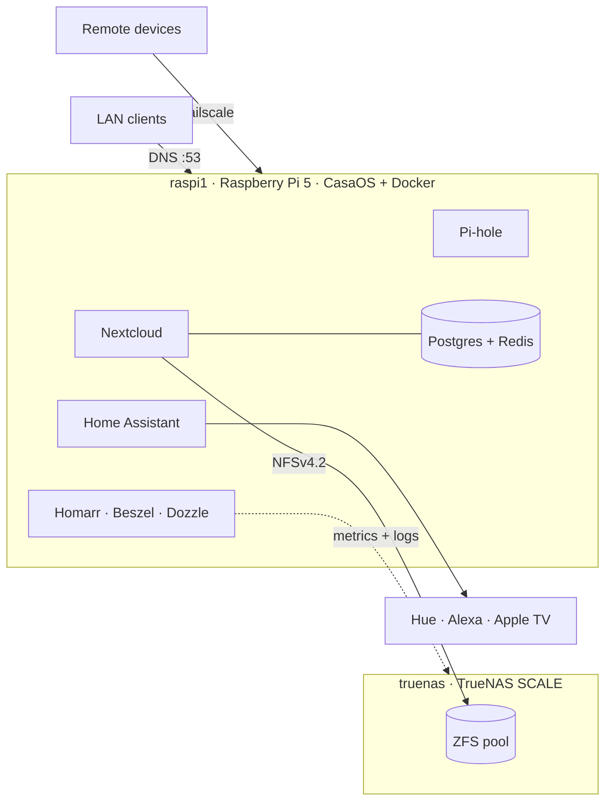

# Homelab

[](https://github.com/Jdben7671/Homelab/actions/workflows/ci.yml)
[](LICENSE)


A two-node self-hosted environment that runs my home's DNS, file sync, smart home and monitoring. Everything is documented as code, from the compose files through the **incident postmortems** to the architecture decisions.

> **Why this repo exists:** the interesting part of running infrastructure is keeping it running. This repo documents the lab as it is *actually deployed* (exported from the live host and sanitized), the outages I debugged, and what I changed afterwards.

<p align="center">
  
  <br><sub>Homarr dashboard: service health, live stats for both hosts, Pi-hole blocking stats, and Dozzle log streams from the Pi and the NAS</sub>
</p>

---

## At a glance

| | |
|---|---|
| **Hosts** | 2: Raspberry Pi 5 (compute) + TrueNAS SCALE (storage) |
| **Services** | 7 running stacks (10 containers) + Tailscale on the host, 2 retired stacks |
| **Storage** | ZFS pool (900 GB) exported over NFSv4.2 |
| **Remote access** | Tailscale (WireGuard mesh). No ports open to the internet |
| **Observability** | Homarr (status) · Beszel (metrics, both hosts) · Dozzle (logs, both hosts) |
| **Docs** | [2 postmortems](incidents/) · [3 runbooks](runbooks/) · [3 ADRs](docs/adr/) · [tech-debt register](docs/tech-debt.md) |
| **CI** | Compose validation · yamllint · shellcheck · gitleaks secret scan · Renovate |

## Architecture



The detailed diagram, boot-order dependencies and design principles are in **[docs/architecture.md](docs/architecture.md)**.

## Hardware

| Host | Hardware | OS | Role |
|---|---|---|---|
| `raspi1` · 192.168.1.57 | Raspberry Pi 5, 8 GB RAM, 128 GB microSD | Debian 13 + CasaOS | Runs all application containers, plus Tailscale on the host |
| `truenas` · 192.168.1.226 | HP EliteDesk G4 mini, internal SSD + 2 × external USB HDD | TrueNAS SCALE | ZFS storage, NFS, monitoring agents |

## Services

| Service | Purpose | Version | Port | Stack |
|---|---|---|---|---|
| **Pi-hole** | Network-wide DNS + ad/tracker blocking | 2026.07.2 | 53, 8080 | [`stacks/pihole`](stacks/pihole/compose.yaml) |
| **Nextcloud** | Self-hosted files, photos, calendar (Postgres 14 + Redis 6.2, data on TrueNAS via NFS) | 35.0.1 | 7580 | [`stacks/nextcloud`](stacks/nextcloud/compose.yaml) |
| **Home Assistant** | Smart home hub: Philips Hue, Alexa, Apple TV | 2026.11.0 | 8123 | [`stacks/homeassistant`](stacks/homeassistant/compose.yaml) |
| **Homarr** | Dashboard: service status + TrueNAS pool health | latest | 7575 | [`stacks/homarr`](stacks/homarr/compose.yaml) |
| **Beszel** | Host and container metrics with history and alerts (hub + agents on both hosts) | 0.21.0 | 8090 | [`stacks/beszel`](stacks/beszel/compose.yaml) |
| **Dozzle** | Live container logs for both hosts (remote agent on TrueNAS) | 11.4.3 | 8888 | [`stacks/dozzle`](stacks/dozzle/compose.yaml) |
| **Compose Toolbox** | Web editor/validator for compose files | latest | 3002 | [`stacks/composetoolbox`](stacks/composetoolbox/compose.yaml) |
| **Tailscale** | Zero-trust remote access (installed on the host) | n/a | n/a | [ADR-0003](docs/adr/0003-tailscale-for-remote-access.md) |
| ~~n8n~~, ~~Nginx Proxy Manager~~ | Retired | | | [`stacks/_retired`](stacks/_retired/) |

The full port map and DNS design are in [docs/networking.md](docs/networking.md).

<p align="center">
  
  <br><sub>Beszel: both hosts reporting CPU, memory, disk, load, temperature and uptime</sub>
</p>

## Engineering highlights

**Real incidents, written up properly.** When TrueNAS rebooted, Nextcloud went down with *"data directory is invalid"*. I traced it down through six layers (app → mount → NFS client → NFS server → ZFS) to a pool `mountpoint` that TrueNAS's `altroot` turned into `/mnt/mnt/...`, and fixed it in place without touching the data. → [INC-001](incidents/2026-11-17-nextcloud-zfs-mountpoint.md)

**Understanding the second-order failure.** Even after the storage was fixed, Nextcloud stayed broken. A running container keeps the empty directory it bind-mounted at start, and NFS `root_squash` made `sudo ls` return a misleading *Permission denied*. → [INC-002](incidents/2026-11-17-nextcloud-stale-bind-mount.md)

**Turning lessons into automation.** [`nextcloud-nfs-guard.sh`](scripts/nextcloud-nfs-guard.sh) + a systemd timer detect *"host sees the data, container doesn't"* and restart only the affected containers. It deliberately refuses to restart onto an empty mount. I considered and rejected making Docker depend on the NFS mount, because that would take DNS down with the NAS.

**Secrets hygiene.** The live CasaOS configs had passwords inline. Here every secret comes from a git-ignored `.env` (see each stack's `.env.example`), and **gitleaks** runs on every push.

**Reproducible, reviewed changes.** Core images are pinned by version *and* `sha256` digest. **Renovate** opens update PRs, major upgrades of stateful services are disabled until migrated by hand, and CI validates every compose file.

**Honest about what's not done.** A [tech-debt register](docs/tech-debt.md) and a [security risk list](docs/security.md#known-risks-accepted-for-now-tracked) from auditing the live host against this repo, including a stale duplicate Pi-hole app, an invalid timezone string, and ZFS on USB disks.

## Skills demonstrated

| Area | Where |
|---|---|
| Linux administration (Debian, systemd, fstab, permissions) | [storage.md](docs/storage.md), [scripts/systemd](scripts/systemd/) |
| Containers (Docker Compose, networks, bind mounts, healthchecks) | [stacks/](stacks/) |
| Storage (ZFS, NFS, UID mapping) | [storage.md](docs/storage.md), [INC-001](incidents/2026-11-17-nextcloud-zfs-mountpoint.md) |
| Networking (DNS, VPN/WireGuard, port planning) | [networking.md](docs/networking.md) |
| Observability | [monitoring.md](docs/monitoring.md), [healthcheck.sh](scripts/healthcheck.sh) |
| Incident response + postmortems | [incidents/](incidents/) |
| CI/CD + supply chain | [.github/workflows/ci.yml](.github/workflows/ci.yml), [renovate.json](renovate.json) |
| Security thinking | [security.md](docs/security.md) |
| Technical writing / decision records | [docs/adr/](docs/adr/), [runbooks/](runbooks/) |

## Repository layout

```
.
├── stacks/              # One Docker Compose project per service (+ .env.example)
│   └── _retired/        # Stopped services, kept for reference
├── docs/
│   ├── architecture.md  # Diagrams, hosts, boot order, design principles
│   ├── storage.md       # ZFS, NFS, permissions, backups
│   ├── networking.md    # IPs, port map, Pi-hole, Tailscale
│   ├── monitoring.md    # Homarr / Beszel / Dozzle
│   ├── home-automation.md
│   ├── security.md      # Controls + known risks
│   ├── tech-debt.md     # Audit findings
│   └── adr/             # Architecture Decision Records
├── incidents/           # Blameless postmortems
├── runbooks/            # Step-by-step procedures
├── scripts/             # healthcheck, NFS guard (+ systemd units), config export
├── .github/workflows/   # CI: compose validate, lint, secret scan
├── renovate.json
└── Makefile             # make check / validate / lint / health
```

## Usage

```bash
make check                 # what CI runs: compose validate + yamllint + shellcheck + gitleaks
make health                # live status of every service from the LAN / tailnet

# Deploying a stack by hand (normally done through CasaOS):
cd stacks/nextcloud
cp .env.example .env && $EDITOR .env
docker compose up -d
```

## Roadmap

- [x] Move Nextcloud data off the Pi onto ZFS ([ADR-0002](docs/adr/0002-nextcloud-data-on-truenas-nfs.md))
- [x] Replace public reverse proxy with Tailscale ([ADR-0003](docs/adr/0003-tailscale-for-remote-access.md))
- [x] Central logs and metrics for both hosts
- [x] Version-control and sanitize all stacks, CI + secret scanning
- [ ] **Backups (3-2-1):** ZFS snapshots, nightly `/DATA/AppData` + `pg_dump` to NAS, encrypted off-site sync, tested restore
- [ ] Deploy `nextcloud-nfs-guard` timer on the Pi
- [ ] Alerting (Beszel → phone) for host down, disk, temperature, failed health check
- [ ] HTTPS everywhere via `tailscale cert`
- [ ] Docker socket proxy for Homarr/Dozzle. Drop `privileged` from Home Assistant
- [ ] Boot the Pi from SSD instead of microSD
- [ ] Clear the [tech-debt register](docs/tech-debt.md)

## License

[MIT](LICENSE)
