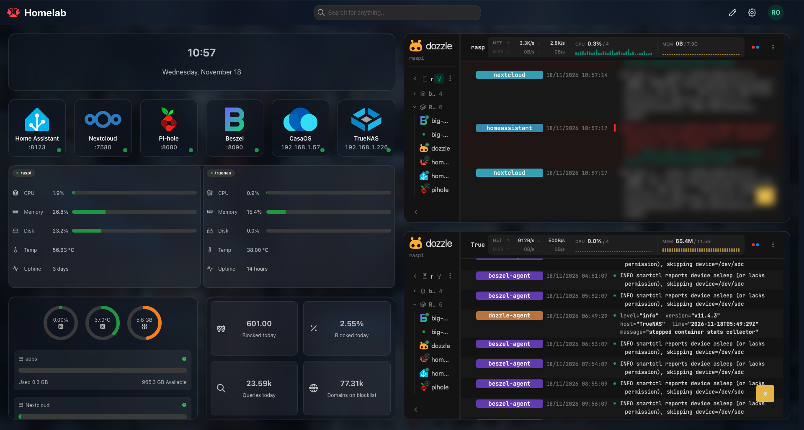
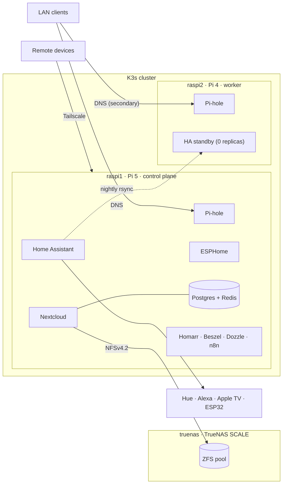
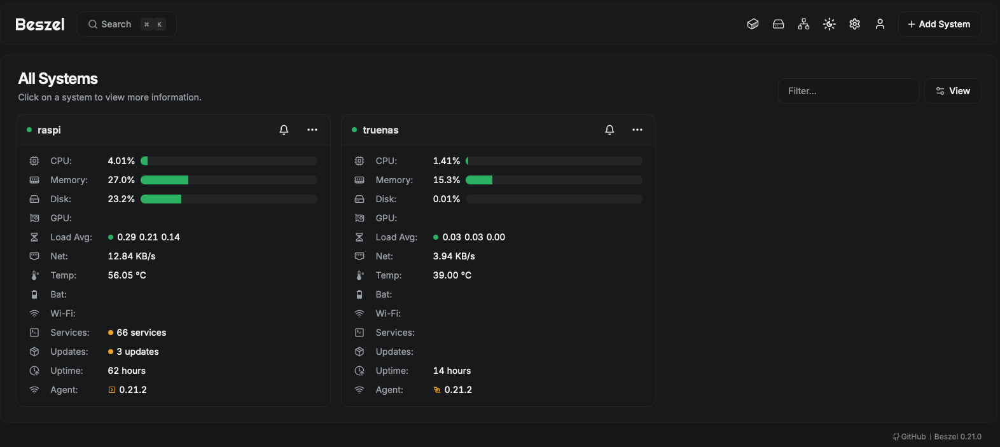

# Homelab

[](https://github.com/Jdben7671/Homelab/actions/workflows/ci.yml)
[](LICENSE)


A self-hosted environment that runs my home's DNS, file sync, smart home and monitoring on a **two-node K3s cluster** (Raspberry Pi 5 + Pi 4) with **TrueNAS** for storage. It is documented as code: Kubernetes manifests, incident postmortems, runbooks and architecture decisions.

> **Why this repo exists:** the interesting part of running infrastructure is keeping it running. This repo documents the lab as it is *actually deployed* (exported from the live cluster and sanitized), the outages I debugged, a full platform migration, and what I changed afterwards.

<p align="center">
  
  <br><sub>Homarr dashboard: service health, live host stats, Pi-hole blocking stats and log streams (captured before the K3s migration)</sub>
</p>

---

## At a glance

| | |
|---|---|
| **Cluster** | K3s v1.37 on 2 nodes: `raspi1` (Pi 5, control plane) + `raspi2` (Pi 4, worker / standby) |
| **Storage** | TrueNAS SCALE, ZFS pool (900 GB) exported over NFSv4.2 |
| **Workloads** | 13 Deployments in 2 namespaces (12 running + the Home Assistant cold standby) |
| **Redundancy** | 2 × Pi-hole (one per node) · Home Assistant cold standby with nightly config replication |
| **Remote access** | Tailscale (WireGuard mesh). No ports open to the internet |
| **Observability** | Homarr (status) · Beszel (host metrics) · Dozzle (logs from every pod, via read-only RBAC) |
| **Docs** | [5 postmortems](incidents/) · [4 runbooks](runbooks/) · [4 ADRs](docs/adr/) · [migration write-up](docs/migration-casaos-to-k3s.md) · [tech-debt register](docs/tech-debt.md) |
| **CI** | kubeconform · compose validation · yamllint · shellcheck · gitleaks (full history) · Renovate |

## Architecture



The detailed diagram, boot order and design principles are in **[docs/architecture.md](docs/architecture.md)**.

## Hardware

| Host | Hardware | Role |
|---|---|---|
| `raspi1` · 192.168.1.57 | Raspberry Pi 5, 8 GB RAM, 128 GB microSD, Debian 13 | K3s server + worker. All stateful workloads. Tailscale on the host |
| `raspi2` · 192.168.1.126 | Raspberry Pi 4, 2 GB RAM, Debian 13 | K3s worker. Secondary DNS, Home Assistant standby |
| `truenas` · 192.168.1.226 | HP EliteDesk G4 mini, internal SSD + 2 × external USB HDD | TrueNAS SCALE: ZFS, NFS |

## Services

| Service | Purpose | Version | Node | Port | Manifest |
|---|---|---|---|---|---|
| **Pi-hole** ×2 | Network-wide DNS + ad/tracker blocking, one resolver per node | 2026.07.2 | both | 53, 8080 | [primary](k8s/pihole-primary.yaml) · [backup](k8s/pihole-backup.yaml) |
| **Nextcloud** | Files, photos, calendar. Postgres 14 + Redis 6.2, data on TrueNAS via NFS | 35.0.1 | raspi1 | 7580 | [`nextcloud.yaml`](k8s/nextcloud.yaml) |
| **Home Assistant** | Smart home: Philips Hue, Alexa, Apple TV, Bluetooth, ESPHome devices | stable | raspi1 (+ standby on raspi2) | 8123 | [primary](k8s/homeassistant-primary.yaml) · [standby](k8s/homeassistant-standby.yaml) |
| **ESPHome** | Build and flash custom ESP32 firmware over USB | 2026.10 | raspi1 | 6052 | [`esphome.yaml`](k8s/esphome.yaml) |
| **Homarr** | Dashboard: service status + TrueNAS pool health | latest | raspi1 | 7575 | [`homarr.yaml`](k8s/homarr.yaml) |
| **Beszel** | Host metrics with history and alerts | 0.21.0 | raspi1 | 8090 | [`beszel.yaml`](k8s/beszel.yaml) |
| **Dozzle** | Live logs from every pod (Kubernetes mode, read-only RBAC) | latest | raspi1 | 8888 | [`dozzle.yaml`](k8s/dozzle.yaml) |
| **n8n** | Workflow automation | latest | raspi1 | 5678 | [`n8n.yaml`](k8s/n8n.yaml) |
| **Tailscale** | Zero-trust remote access (on the host) | | raspi1 | | [ADR-0003](docs/adr/0003-tailscale-for-remote-access.md) |

The full port map and DNS design are in [docs/networking.md](docs/networking.md). The pre-migration Docker Compose versions are in [`legacy/`](legacy/).

<p align="center">
  
  <br><sub>Beszel: host metrics for the Pi and the NAS</sub>
</p>

## Engineering highlights

**Migrated a live single-host Docker setup to Kubernetes without losing data.** Every service moved from CasaOS to a two-node K3s cluster one service at a time, reusing every data directory in place. Kubernetes Services named after the old Docker hostnames meant Nextcloud's `config.php` needed no edits. → [migration write-up](docs/migration-casaos-to-k3s.md) · [ADR-0004](docs/adr/0004-migrate-to-k3s.md)

**Built redundancy before it was needed, then used it.** During the migration, a CasaOS "Uninstall" deleted Home Assistant's whole config directory. The cold standby set up a few hours earlier had a copy, and HA was restored in minutes. → [INC-004](incidents/2026-11-25-casaos-uninstall-deleted-ha-config.md)

**Debugging through the layers.** Nextcloud's *"data directory is invalid"* traced from the app down to a ZFS `mountpoint` that TrueNAS's `altroot` turned into `/mnt/mnt/...` → [INC-001](incidents/2026-11-17-nextcloud-zfs-mountpoint.md). Alexa dropping every 30 minutes traced from the container outward to the router's WAN DHCP renewals behind double NAT → [INC-003](incidents/2026-11-24-alexa-disconnects-wan-dhcp-renewal.md).

**Supply-chain lessons from a real outage.** A pinned image tag vanished from Docker Hub mid-migration. I recovered it from a digest-only local copy, and documented why pinning without mirroring isn't enough. → [INC-005](incidents/2026-11-25-nextcloud-image-removed-upstream.md)

**Least privilege where possible.** Home Assistant went from `privileged` to just `NET_ADMIN`/`NET_RAW` (found by debugging a degraded-Bluetooth warning). Dozzle went from the Docker socket to a read-only ClusterRole. → [security.md](docs/security.md)

**Turning lessons into automation.** [`nextcloud-nfs-guard.sh`](scripts/nextcloud-nfs-guard.sh) + a systemd timer detect *"host sees the NFS data, pod doesn't"* and restart only Nextcloud. It deliberately refuses to restart onto an empty mount.

**Honest about what's not done.** A [tech-debt register](docs/tech-debt.md) and [risk list](docs/security.md#known-risks-accepted-for-now-tracked) from auditing the live cluster against this repo, such as a standby manifest that would start a second Home Assistant if re-applied, and an image that exists only on one SD card.

## Skills demonstrated

| Area | Where |
|---|---|
| Kubernetes (K3s, Deployments, Services, RBAC, node placement, hostNetwork, capabilities) | [k8s/](k8s/), [migration](docs/migration-casaos-to-k3s.md) |
| Platform migration with zero data loss | [migration-casaos-to-k3s.md](docs/migration-casaos-to-k3s.md) |
| High availability / disaster recovery | [HA failover runbook](runbooks/home-assistant-failover.md), [INC-004](incidents/2026-11-25-casaos-uninstall-deleted-ha-config.md) |
| Linux administration (Debian, systemd, cron, rsync, fstab, permissions) | [storage.md](docs/storage.md), [scripts/](scripts/) |
| Storage (ZFS, NFS, UID mapping, mount propagation) | [storage.md](docs/storage.md), [INC-001](incidents/2026-11-17-nextcloud-zfs-mountpoint.md), [INC-002](incidents/2026-11-17-nextcloud-stale-bind-mount.md) |
| Networking (DNS redundancy, double NAT, VPN/WireGuard, port planning) | [networking.md](docs/networking.md), [INC-003](incidents/2026-11-24-alexa-disconnects-wan-dhcp-renewal.md) |
| Observability | [monitoring.md](docs/monitoring.md), [healthcheck.sh](scripts/healthcheck.sh) |
| Incident response + blameless postmortems | [incidents/](incidents/) |
| CI/CD + supply chain | [ci.yml](.github/workflows/ci.yml), [renovate.json](renovate.json), [INC-005](incidents/2026-11-25-nextcloud-image-removed-upstream.md) |
| Security thinking | [security.md](docs/security.md) |
| Technical writing / decision records | [docs/adr/](docs/adr/), [runbooks/](runbooks/) |

## Repository layout

```
.
├── k8s/                 # Live K3s manifests (sanitized; credentials via Secrets)
├── docs/
│   ├── architecture.md  # Diagrams, nodes, boot order, design principles
│   ├── migration-casaos-to-k3s.md
│   ├── storage.md       # ZFS, NFS, permissions, backups
│   ├── networking.md    # IPs, port map, two Pi-holes, Tailscale
│   ├── monitoring.md · home-automation.md · security.md · tech-debt.md
│   └── adr/             # Architecture Decision Records
├── incidents/           # Blameless postmortems
├── runbooks/            # Step-by-step procedures (kubectl)
├── scripts/             # healthcheck, NFS guard (+ systemd units), config export
├── legacy/              # Pre-migration CasaOS / Docker Compose stacks
├── .github/workflows/   # CI
├── renovate.json
└── Makefile             # make check / k8s / lint / health
```

## Usage

```bash
make check     # what CI runs: kubeconform + compose validate + yamllint + shellcheck + gitleaks
make health    # live status of every service and both DNS resolvers

# Deploy (on raspi1): create the Secrets first, see k8s/secrets.example.yaml
sudo k3s kubectl apply -f k8s/nextcloud.yaml
```

## Roadmap

- [x] Move Nextcloud data off the Pi onto ZFS ([ADR-0002](docs/adr/0002-nextcloud-data-on-truenas-nfs.md))
- [x] Replace public reverse proxy with Tailscale ([ADR-0003](docs/adr/0003-tailscale-for-remote-access.md))
- [x] Migrate CasaOS/Docker to a two-node K3s cluster ([ADR-0004](docs/adr/0004-migrate-to-k3s.md))
- [x] Redundant DNS and a Home Assistant cold standby
- [x] Rotate default credentials. No secrets in manifests
- [ ] **Backups (3-2-1):** ZFS snapshots, versioned (not mirrored) HA config, nightly `/DATA/AppData` + `pg_dump` to NAS, off-site sync, tested restore
- [ ] Mirror the Nextcloud image, then move to the official image ([INC-005](incidents/2026-11-25-nextcloud-image-removed-upstream.md))
- [ ] Fix Tailscale DNS for mobile clients. Add raspi2 to Beszel
- [ ] Traefik Ingress + TLS for the web UIs
- [ ] Resource requests/limits and health probes on every workload
- [ ] Remove Docker and CasaOS from raspi1
- [ ] Boot raspi1 from SSD instead of microSD
- [ ] Clear the [tech-debt register](docs/tech-debt.md)

## License

[MIT](LICENSE)
