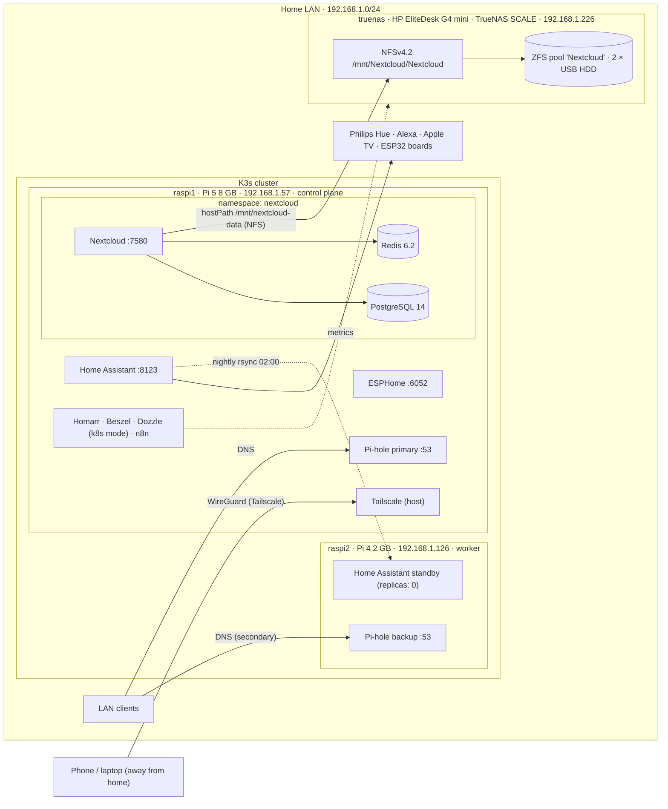
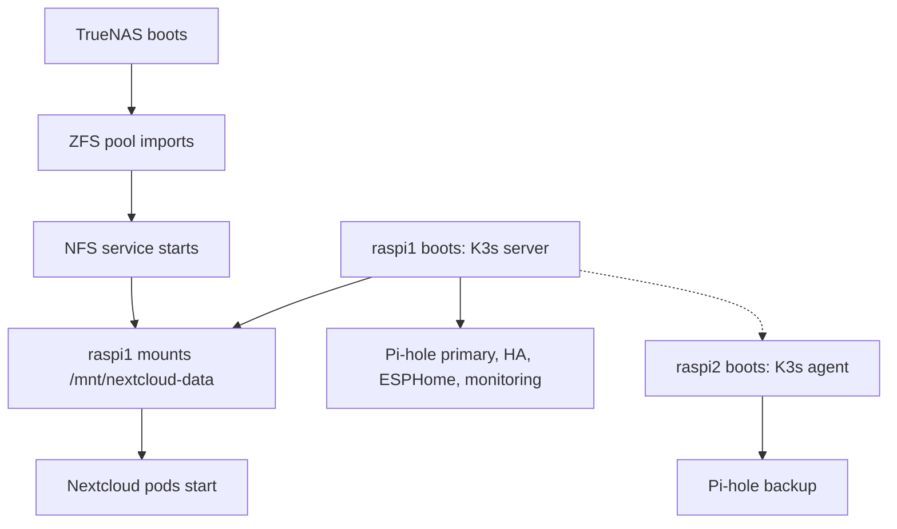

# Architecture

Three machines, each with a clear job:

- **`raspi1`** (Raspberry Pi 5) is the K3s control plane and primary worker, and runs every stateful workload.
- **`raspi2`** (Raspberry Pi 4) is a K3s worker that provides **redundancy**: a second Pi-hole and a cold-standby Home Assistant.
- **`truenas`** owns bulk storage (ZFS) and shares it over NFS.

Until 2026-11-25 everything ran as Docker containers under CasaOS on `raspi1` alone. See the [migration write-up](migration-casaos-to-k3s.md) and [ADR-0004](adr/0004-migrate-to-k3s.md).

## Hosts

| Host | Hardware | Role |
|---|---|---|
| `raspi1` · 192.168.1.57 | Raspberry Pi 5 (8 GB RAM), 128 GB microSD, Debian 13 | K3s server (control plane) + worker. Runs Nextcloud, Home Assistant, ESPHome, Pi-hole primary, monitoring. Tailscale on the host |
| `raspi2` · 192.168.1.126 | Raspberry Pi 4 (2 GB RAM) | K3s agent (worker). Pi-hole backup, Home Assistant cold standby |
| `truenas` · 192.168.1.226 | HP EliteDesk G4 mini, internal SSD + 2 external USB HDDs, TrueNAS SCALE | ZFS storage, NFS server, Beszel agent |

## Design principles

1. **Separate compute from storage.** Pods use `hostPath` volumes on the Pi for small app config (`/DATA/AppData`). Bulk user data lives on ZFS on the NAS.
2. **Redundancy where it's cheap and matters most.** DNS runs on *both* nodes, because if it's down the whole house is "offline". Home Assistant has a warm config copy on the second node.
3. **Placement over magic.** Workloads are pinned with `nodeSelector`. With `hostPath` storage and a 2 GB second node, automatic rescheduling would do more harm than good. Failover is a deliberate, documented `kubectl scale` ([runbook](../runbooks/home-assistant-failover.md)).
4. **Keep the edges stable.** `hostNetwork`/`hostPort` keep every service on the same IP:port it had before. Kubernetes Services reuse the old Docker hostnames (`db-nextcloud`, `redis-nextcloud`).
5. **Everything observable from one place.** Homarr for status, Beszel for host metrics, Dozzle for logs from every pod.
6. **No inbound ports from the internet.** Remote access goes over Tailscale ([ADR-0003](adr/0003-tailscale-for-remote-access.md)).
7. **Secrets never in Git.**

## Dependencies and boot order

Only Nextcloud depends on the NAS. See [`runbooks/boot-order.md`](../runbooks/boot-order.md).

Related: [storage](storage.md) · [networking](networking.md) · [monitoring](monitoring.md) · [security](security.md) · [migration](migration-casaos-to-k3s.md)
