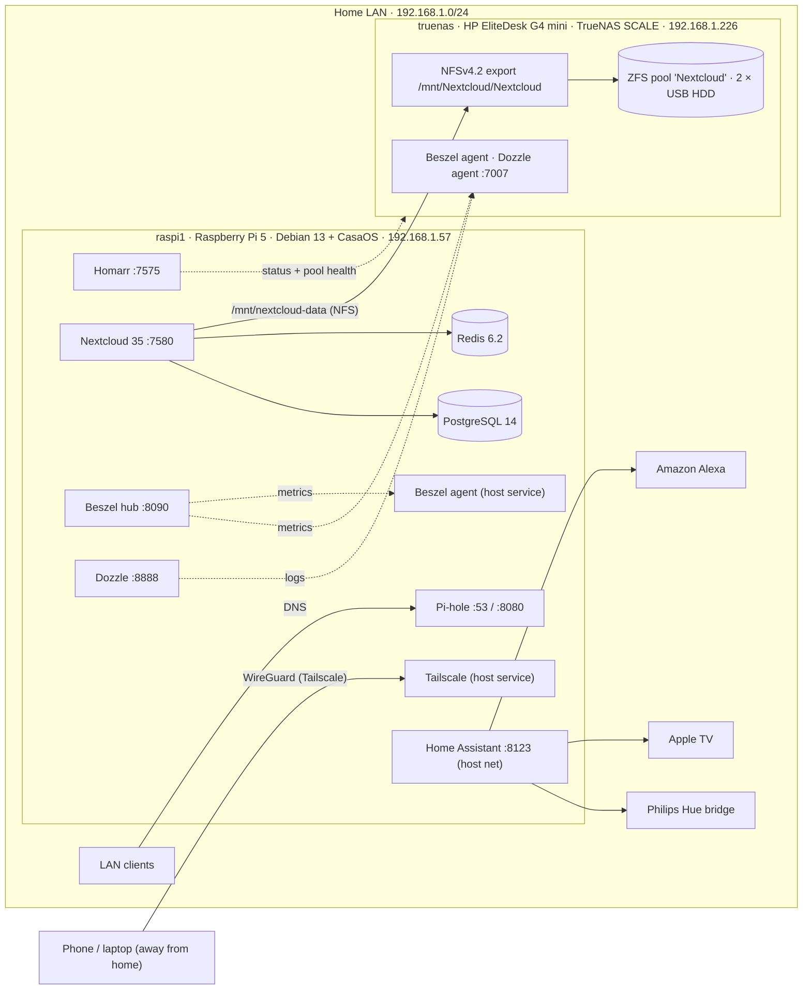
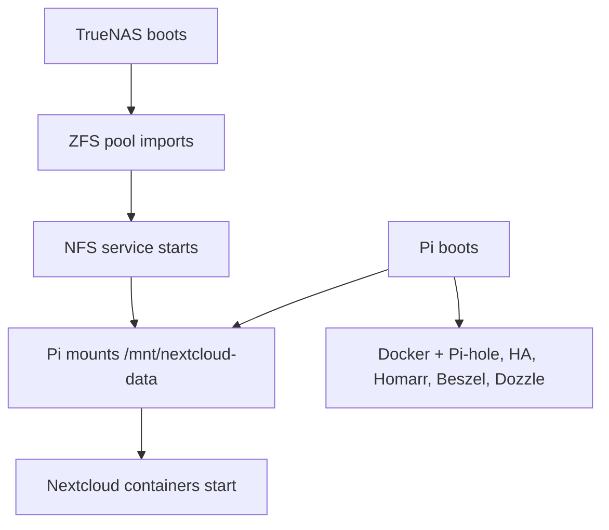

# Architecture

The lab has two hosts with separate jobs. **Compute** runs on a low-power Raspberry Pi. **Storage** runs on a dedicated TrueNAS box. They are linked by NFS. All apps are Docker containers managed through CasaOS on the Pi.

## Hosts

| Host | Hardware | OS | Role |
|---|---|---|---|
| `raspi1` · 192.168.1.57 | Raspberry Pi 5 (8 GB RAM), 128 GB microSD | Debian 13 "trixie" + CasaOS, Docker | Runs every application container, plus Tailscale on the host |
| `truenas` · 192.168.1.226 | HP EliteDesk G4 mini, internal SSD + 2 external USB HDDs | TrueNAS SCALE | ZFS storage, NFS server, monitoring agents |

## Design principles

1. **Separate compute from storage.** The Pi's microSD card holds only small app config (`/DATA/AppData`). Bulk user data lives on ZFS on the NAS. If the Pi dies, the data survives, and so does the reverse.
2. **One compose project per app.** Each stack in [`stacks/`](../stacks) has its own network and lifecycle, so restarting Nextcloud never touches DNS.
3. **Everything observable from one place.** Homarr shows service status, Beszel shows host metrics for both machines, and Dozzle shows container logs for both machines.
4. **No inbound ports from the internet.** Remote access goes over Tailscale (see [ADR-0003](adr/0003-tailscale-for-remote-access.md)).
5. **Secrets never in Git.** Each stack reads them from a git-ignored `.env`. Each stack has a `.env.example` showing which variables it needs.

## Dependencies and boot order

Everything except Nextcloud works without the NAS. Nextcloud is the only cross-host dependency, so it is the service with a runbook, a guard script and two incident write-ups. See [`runbooks/boot-order.md`](../runbooks/boot-order.md).

Related: [storage](storage.md) · [networking](networking.md) · [monitoring](monitoring.md) · [security](security.md)
