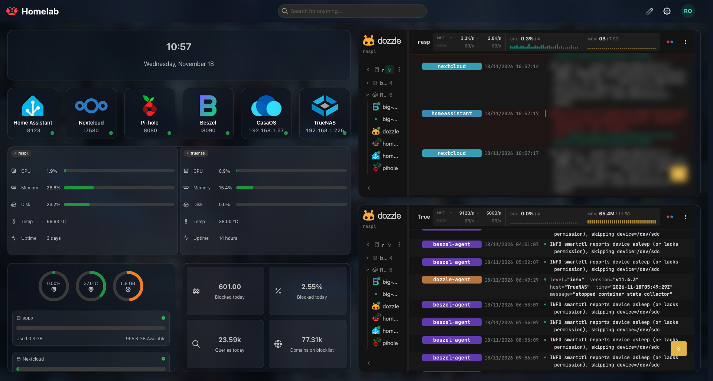
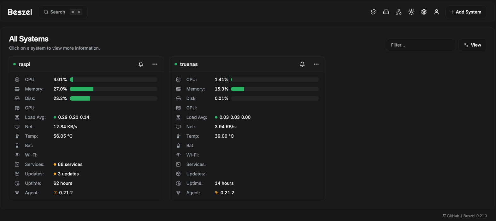

# Monitoring and observability

Three tools, each answering a different question:

| Question | Tool | Where |
|---|---|---|
| *Is every service up right now?* | **Homarr** board with status tiles for each app, plus the TrueNAS integration showing pool state | `:7575/boards/homelab` |
| *Is the hardware OK? CPU, RAM, disk, temperatures, history?* | **Beszel** hub on raspi1, agents (0.21.2) on raspi1 and TrueNAS. raspi2 still to be added | `:8090` |
| *What is a pod actually saying?* | **Dozzle** in Kubernetes mode streams logs from every pod on both nodes, using a read-only ServiceAccount (no Docker socket). Since the migration it no longer shows TrueNAS's container logs | `:8888` |
| *Is it healthy from a client's point of view?* | [`scripts/healthcheck.sh`](../scripts/healthcheck.sh) does HTTP checks for every service and DNS checks against **both** Pi-holes, with a non-zero exit code on failure | CLI |
| *What does the cluster think?* | `sudo k3s kubectl get pods -A -o wide`, `kubectl get events -A --sort-by=.lastTimestamp` | CLI |

A typical day, as captured above: the Pi idles at about 2–4 % CPU, 27 % RAM and about 56 °C. Pi-hole answers about 23.6k DNS queries per day against a 77k-domain blocklist and blocks about 2.5 % of them.

## How it played out in a real incident

During [INC-001](../incidents/2026-11-17-nextcloud-zfs-mountpoint.md):

1. The **Homarr** Nextcloud tile went red. That was detection.
2. **Beszel** showed TrueNAS itself was up, which ruled out "the NAS is off".
3. Nextcloud's `status.php` returned HTTP 503 *"data directory is invalid"*, which pointed at storage.
4. Mounting the share by hand surfaced `access denied by server`, which pointed at the NFS share and then at the ZFS mountpoint.

The layering paid off: each tool narrowed the problem down one level.

## Gaps / next steps

- Alerting: Beszel supports alerts (email/webhook). Wire them to a phone notification for: host down, disk > 85 %, Pi temperature > 75 °C.
- Run `healthcheck.sh --quiet` from cron and alert on a non-zero exit.
- Add `raspi2` to Beszel (agent as a DaemonSet or host service).
- Alert if the nightly Home Assistant sync (`/var/log/ha-sync.log`) reports errors.
- ZFS scrub results and SMART data from the USB HDDs should feed an alert, not only a dashboard.
